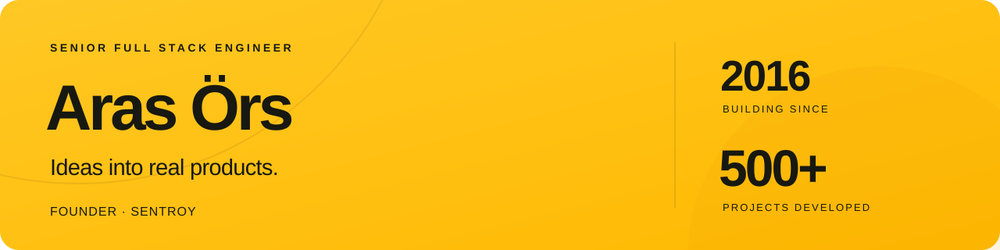

  

  <a href="https://www.linkedin.com/in/arasors/">LinkedIn</a>
  &nbsp;·&nbsp;
  <a href="https://www.upwork.com/freelancers/~01ee3382ccf6d07f2e">Work with me</a>
  &nbsp;·&nbsp;
  <a href="https://www.youtube.com/watch?v=qo3q7vVJ1hg">Watch my 60-second introduction</a>

### About me

I'm a **Senior Full Stack Engineer** and the founder of [SENTROY](https://sentroy.com/). I've been building digital products since **2016**, with **500+ projects** across product development and client work.

I work across web, mobile, and desktop, from the first sketch to the interface, backend services, and release. I help founders and teams build SaaS products, finish existing applications, and ship the next useful feature.

### Selected work

A few recent examples from a much larger project history:

| Project | My work |
| :--- | :--- |
| [**SENTROY**](https://sentroy.com/) | Founder and full stack engineer. Building connected applications for email, storage, notes, restaurant operations, and team communication. |
| [**Chaby**](https://chaby.sentroy.com/en) | Team collaboration and customer support in the SENTROY ecosystem, including web and Flutter development. |

### Languages & tools

**Languages**

  <code></code>
  <code></code>
  <code></code>
  <code></code>

**Frameworks & platforms**

  <code></code>
  <code></code>
  <code></code>
  <code></code>
  <code></code>
  <code></code>
  <code></code>
  <code></code>
  <code></code>
  <code></code>
  <code></code>

**Tools**

  <code></code>
  <code></code>
  <code></code>
  <code></code>
  <code></code>

I also create product demos with **Remotion**.

### Let's build something useful

Have a product to build or an application that needs to move forward? Reach out on [LinkedIn](https://www.linkedin.com/in/arasors/) or [Upwork](https://www.upwork.com/freelancers/~01ee3382ccf6d07f2e).
